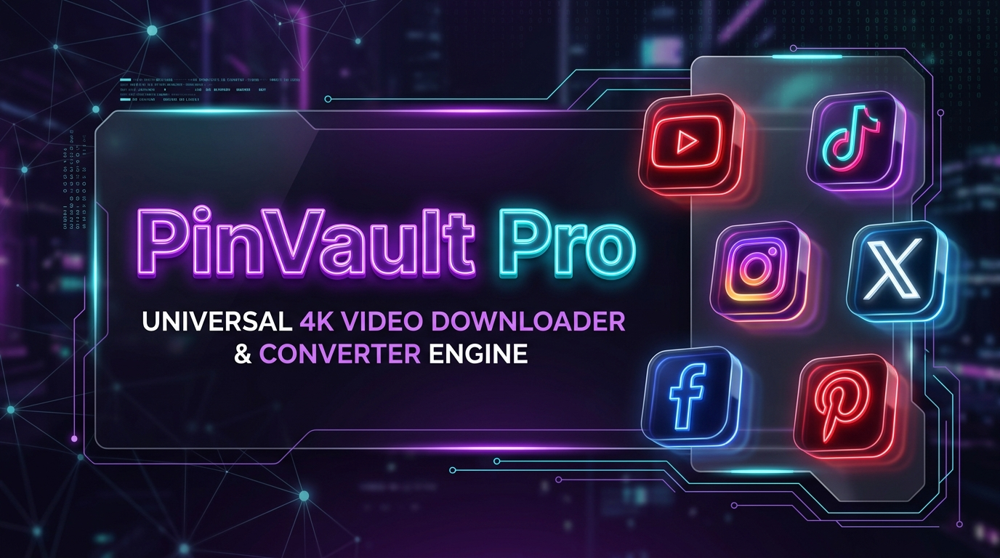
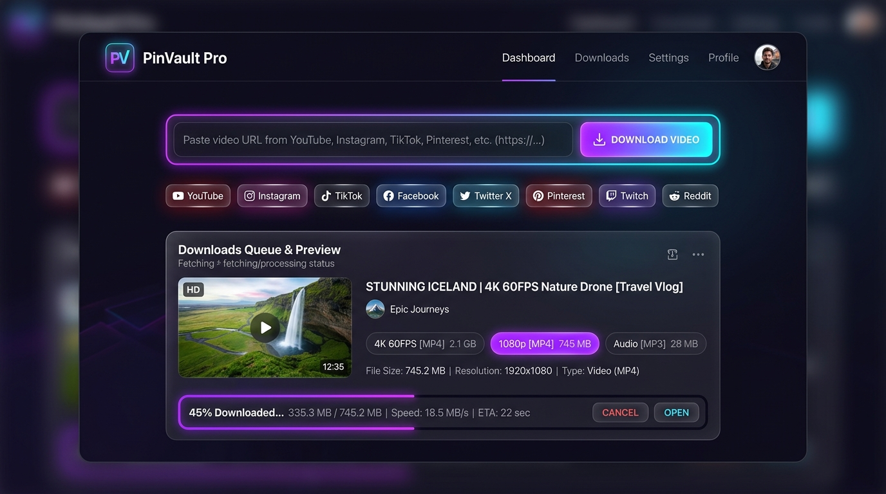
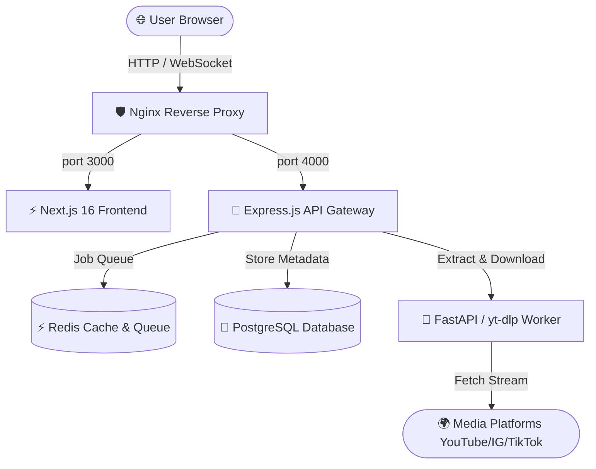

<div align="center">



# ⚡ PinVault Pro
### Universal 4K Video Downloader & Converter Engine

[](https://nextjs.org/)
[](https://fastapi.tiangolo.com/)
[](https://expressjs.com/)
[](https://www.docker.com/)
[](LICENSE)

<p align="center">
  A high-performance, modern web application and microservice architecture to extract, convert, and download media from <b>1000+ platforms</b> in up to <b>4K UHD 60FPS</b> and <b>320kbps MP3</b>.
</p>

[Live Demo](#-live-preview) • [Features](#-key-features) • [Architecture](#-architecture) • [Getting Started](#-getting-started) • [Deployment](#-deployment)

</div>

---

## 📸 Live Preview

<div align="center">



</div>

---

## ✨ Key Features

- 🌐 **1000+ Platforms Supported**: YouTube, Instagram (Reels/Stories/Posts), TikTok (No watermark), Facebook, Twitter/X, Pinterest, Reddit, Twitch, and more.
- 🎯 **Smart Format Extraction**: Automatically extracts 4K UHD, 1440p, 1080p Full HD, 720p, 480p MP4, and high-fidelity 320kbps MP3 audio formats.
- ⚡ **Asynchronous Microservice Architecture**: FastAPI + yt-dlp backend with resilient streaming pipeline and real-time processing.
- 🎨 **Next.js 16 + React 19 Frontend**: Ultra-fast responsive UI with glassmorphic cyberpunk dark mode, smooth transitions, and instant feedback.
- 📡 **Real-time Download Progress**: Websocket & SSE supported download worker with granular progress updates.
- 📢 **Ad-Sense & Banner Ready**: Optimized layout with native slots for Google AdSense, banners, and affiliate placements.
- 🐳 **1-Command Docker Deployment**: Production-ready `docker-compose.yml` with Postgres, Redis, Python worker, Node.js API, Next.js UI, and Nginx.

---

## 🌐 Supported Platforms

| Platform | Video (HD / 4K) | Audio (MP3) | Reels / Shorts | Stories |
| :--- | :---: | :---: | :---: | :---: |
| **YouTube** | ✅ Up to 4K | ✅ 320kbps | ✅ Yes | N/A |
| **Instagram** | ✅ 1080p HD | ✅ Yes | ✅ Reels | ✅ Yes |
| **TikTok** | ✅ No Watermark | ✅ Original Audio | ✅ Yes | N/A |
| **Twitter / X** | ✅ Highest Bitrate | ✅ Yes | ✅ Clips | N/A |
| **Facebook** | ✅ 1080p HD | ✅ Yes | ✅ Reels | ✅ Yes |
| **Pinterest** | ✅ Original MP4 | ✅ Yes | ✅ Pins | N/A |
| **Reddit** | ✅ Merged Audio+Video | ✅ Yes | ✅ Clips | N/A |

---

## 🏛️ Architecture



---

## 🚀 Getting Started

### Prerequisites
- [Docker](https://www.docker.com/) & Docker Compose (Recommended)
- Or Node.js 20+, Python 3.11+, and PostgreSQL

### Quickstart (Docker Compose)

1. **Clone the repository:**
   ```bash
   git clone https://github.com/kxbir-git/PinVault-Pro---Universal-Video-Downloader.git
   cd PinVault-Pro---Universal-Video-Downloader
   ```

2. **Configure environment:**
   ```bash
   cp .env.example .env
   ```

3. **Start the complete stack:**
   ```bash
   docker compose up -d --build
   ```

4. **Access the application:**
   - Frontend UI: `http://localhost:3000` (or `http://localhost` with Nginx)
   - API Gateway: `http://localhost:4000`
   - Python Downloader API: `http://localhost:8001`
   - API Docs: `http://localhost:4000/api-docs`

---

## 🛠️ Local Development (Without Docker)

### 1. Python Downloader Service
```bash
cd python-service
python -m venv venv
# On Windows:
.\venv\Scripts\activate
# On Linux/macOS:
source venv/bin/activate

pip install -r requirements.txt
uvicorn main:app --host 0.0.0.0 --port 8001 --reload
```

### 2. Frontend
```bash
cd frontend
npm install
npm run dev
```

### 3. Backend API Gateway
```bash
cd backend-api
npm install
npm run dev
```

---

## ⚙️ Environment Variables

Copy `.env.example` to `.env` and configure:

| Variable | Description | Default |
| :--- | :--- | :--- |
| `PORT` | Backend API Port | `4000` |
| `PYTHON_SERVICE_URL` | URL to Python Downloader | `http://localhost:8001` |
| `NEXT_PUBLIC_API_URL` | Frontend API Target | `http://localhost:4000` |
| `DATABASE_URL` | PostgreSQL Connection String | `postgresql://...` |
| `REDIS_URL` | Redis Connection String | `redis://localhost:6379` |
| `JWT_SECRET` | Secret key for auth tokens | `your-secret-key` |

---

## 🚢 Deployment

Detailed instructions for deploying to **Vercel, Render, Railway, or VPS** are documented in:
📄 [**DEPLOYMENT.md**](DEPLOYMENT.md)

---

## 🤝 Contributing

Contributions, issues, and feature requests are welcome!
1. Fork the Project
2. Create your Feature Branch (`git checkout -b feature/AmazingFeature`)
3. Commit your Changes (`git commit -m 'Add some AmazingFeature'`)
4. Push to the Branch (`git push origin feature/AmazingFeature`)
5. Open a Pull Request

---

## 📄 License

Distributed under the **MIT License**. See `LICENSE` for more information.
